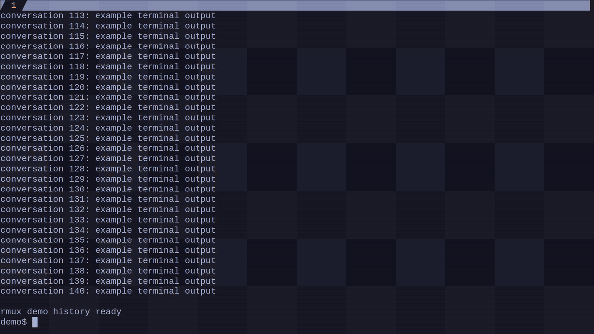

# rmux

rmux keeps named terminal sessions running independently of the terminal windows attached to them. Each session has one shared split layout and one or more independently running buffers.

See the [full guide](docs/README.md) for installation, keyboard controls, Vim navigation, and configuration.
